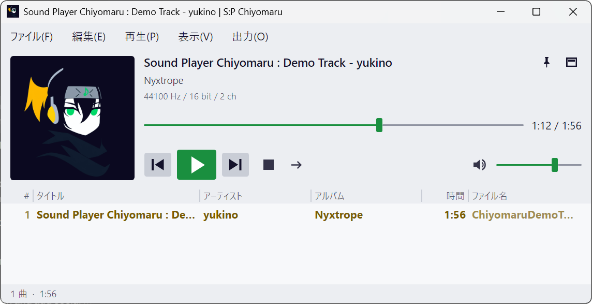
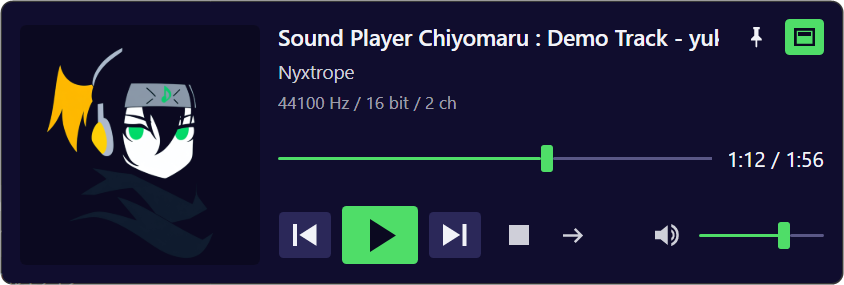
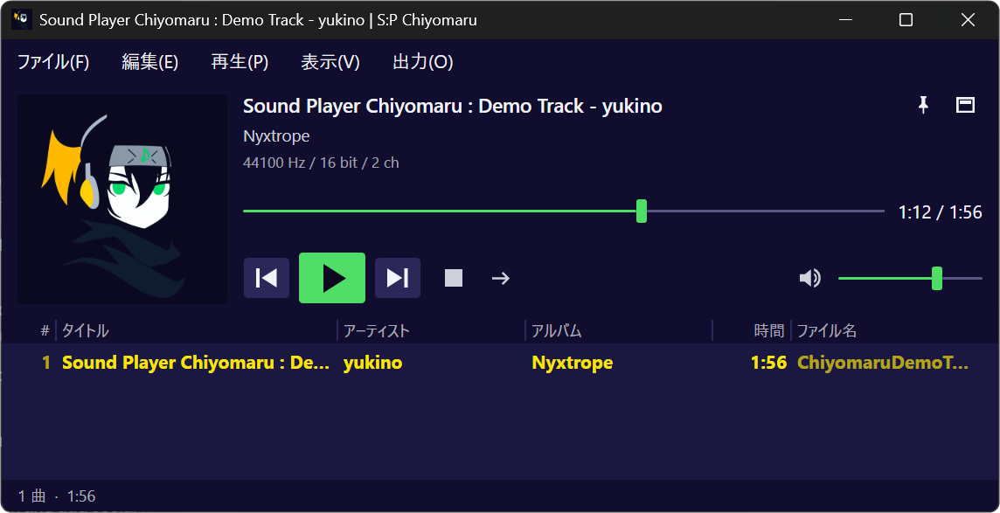

# SoundPlayerChiyomaru

[English](README.md) | 日本語

Windows 11 向けの、軽くて速い音楽プレーヤーです。ファイルやフォルダを放り込めば、すぐに再生できます。

<p align="center">
  
</p>

## 特長

- **起動が速く、軽い** — 起動してウィンドウが出るまで約 0.1 秒、再生中のメモリは 100MB 以下が目安です（作者の環境での計測）。Native AOT でビルドしているので、.NET のランタイムのインストールも要りません。
- **ライブラリを持たない** — 曲を取り込んで管理する仕組みはありません。聴きたいファイルやフォルダをウィンドウにドラッグ & ドロップするだけです。前回のプレイリストは次の起動時にそのまま残ります。
- **プレイリストの編集が手軽** — ドラッグでの並べ替え、見出しのクリックでのソート、選んだ曲の移動、元に戻す・やり直しができます。
- **音を加工しない** — イコライザーやクロスフェードは入れていません。WASAPI の排他モードにも対応しています。
- **ギャップレス再生**、ReplayGain、タグとアルバムアートワークの表示、メディアキーに対応しています。
- **インストール不要** — フォルダごと好きな場所に置いて使えます。設定もそのフォルダの中に保存します。
- **日本語と英語** — 画面の言語は Windows の表示言語に従います。設定で選ぶこともできます。

<p align="center">
  
  &nbsp;
  
</p>
<p align="center">ミニモード。配色は、独自の配色と Windows の配色のそれぞれで、明るい・暗い・Windows の設定に合わせる、から選べます。</p>

## ダウンロード

[Releases](../../releases) から `SoundPlayerChiyomaru-<バージョン>-win-x64.zip` をダウンロードして、自分専用のフォルダに展開します（ほかのダウンロードしたファイルと並ぶ、ダウンロードのフォルダに直接展開するのは避けてください）。`-symbols.zip` は不具合を調べるためのファイルなので、使うだけなら不要です。

署名のないアプリなので、初めて起動するときに Windows の SmartScreen の画面が出ることがあります。その場合は「詳細情報」から「実行」を選んでください。

## 動作環境

- Windows 11（64 ビット）
- 追加のインストールは不要です。

## 対応している形式

| 種類 | 形式 |
|---|---|
| 曲 | MP3、FLAC、WAV、AAC（M4A）、WMA |
| プレイリスト（読み込み） | M3U8、M3U、PLS |
| プレイリスト（保存） | M3U8 |

タグ（タイトル、アーティスト、アルバムなど）とアルバムアートワークを表示します。アートワークがタグにない場合は、曲と同じフォルダの `folder.jpg` を使います。

## 使い方

### 起動する

展開したフォルダの `SoundPlayerChiyomaru.exe` を実行します。フォルダの中のファイル（`.dll` など）は、まとめて同じ場所に置いてください。

設定（`settings.json`）と、作業中のプレイリスト（`playlist.m3u8`）は、同じフォルダに保存されます。アンインストールするときは、フォルダごと削除します。

### 曲を再生する

- ウィンドウに、曲のファイルやフォルダをドラッグ & ドロップします。
  - プレイリストの中に落とすと、その位置に追加します。
  - それ以外の場所（曲名や再生ボタンのあたり）に落とすと、プレイリストを置き換えて再生します。この動作は設定で「末尾に追加」「追加して再生」に変えられます。
- または「ファイル」メニューの「開く」「ファイルを追加」「フォルダを追加」を使います。
- プレイリストの曲をダブルクリックすると、その曲から再生します。

### プレイリストを編集する

- 曲をドラッグして並べ替えられます。複数選んでまとめて動かすこともできます。
- 曲を右クリックすると、「この曲から再生」「次にこの曲から再生」「並べ替え」「シャッフル」「プレイリストから削除」などが選べます。
- 右クリックの「移動」で、選んだ曲を「上へ」「下へ」「再生中の曲の次へ」「先頭へ」「最後尾へ」動かせます。上と下は Alt+↑ / Alt+↓ でも動かせます。
- 編集は「元に戻す」（Ctrl+Z）で取り消せます。
- 見出し（タイトル、アーティストなど）をクリックすると、その列で並べ替えます。もう一度クリックすると逆の順になります。並べ替えはプレイリストの並びそのものを変えますが、「元に戻す」で戻せます。
- 見出しの境目をドラッグすると列の幅が、見出しそのものをドラッグすると列の順番が変わります。見出しを右クリックすると、列を隠したり足したりできます。
- 左端の「#」は曲順の番号です。シャッフルや並べ替えをしても番号は曲に付いたままなので、「並べ替え」→「曲順（#）」で元の順に戻せます。

「プレイリストから削除」は一覧から外すだけで、ファイルは消しません。

### 再生モード

停止ボタンの右のボタン、または「再生」メニューの「再生モード」で切り替えます。

| モード | 動き |
|---|---|
| 通常 | 順に再生して、最後の曲で止まります |
| 1曲リピート | 今の曲を繰り返します |
| 全曲リピート | 最後の曲の次は、最初に戻ります |
| ランダム | 無作為に選んで再生し続けます |
| 1ショット | 今の曲が終わったら止まります |

全曲を 1 回ずつ無作為な順で聴きたいときは、「プレイリストをシャッフル」で並びを入れ替えてから、通常モードで再生します。

### 排他モード

「出力」メニューで使うデバイスを選び、「排他モード」にチェックを入れると、そのデバイスをこのアプリだけで使います。音量を最大にし、ReplayGain をオフにすると、デコードした音を値を変えずにデバイスへ渡せます。そうなっている間は、曲名の右に「BP」の印が出ます。排他モードなのにそうできていないときは「× BP」に変わり、マウスを乗せると理由が出ます。

排他モードの間は、他のアプリの音（通知音を含む）がそのデバイスから鳴らなくなります。

### ミニモード

曲名の右のボタン、または Ctrl+M で、プレイリストを隠した小さなウィンドウに切り替えます。曲名のあたりをつかんで動かします。同じボタンか Ctrl+M で元に戻せます。

曲名や操作のボタンのあたりを右クリックすると、メニューバーと同じ「ファイル」「再生」「表示」「出力」のメニューと「閉じる」が出ます。ミニモードでも、ここから出力の切り替えや設定を開けます。

### 設定

「ファイル」メニューの「設定」（Ctrl+,）で開きます。変更はその場で反映されます。出力のバッファの長さ、配色（「表示」メニューからも変えられます）、表示する列、他のアプリからファイルを開いたときの動作、ファイルの関連付けなどを変えられます。

画面の言語は、「表示」ページの「言語 / Language」で、「Windows の設定に従う」（既定）、「日本語」、「English」から選べます。言語の変更は再起動後に反映されます。「今すぐ再起動」を押すと、その場で再起動します。プレイリストと選んでいた曲はそのまま残ります。

<p align="center">
  
</p>

### キーボード操作

| 操作 | キー |
|---|---|
| 再生 / 一時停止 | Space |
| 停止 | Ctrl+Space |
| 次の曲 / 前の曲 | Ctrl+→ / Ctrl+← |
| 5 秒進む / 戻る | → / ←（シークバーの上でホイールを回しても動きます） |
| 音量を上げる / 下げる | Ctrl+↑ / Ctrl+↓（音量のスライダーの上でホイールを回しても変わります） |
| ミュート | M |
| ミニモード | Ctrl+M |
| 常に手前に表示 | Ctrl+T |
| 設定 | Ctrl+, |
| 開く | Ctrl+O |
| プレイリストを上書き保存 / 名前を付けて保存 | Ctrl+S / Ctrl+Shift+S |
| 元に戻す / やり直し | Ctrl+Z / Ctrl+Y |
| 選んだ曲を上へ / 下へ | Alt+↑ / Alt+↓ |
| プレイリストから削除 | Delete |
| すべて選択 | Ctrl+A |

キーボードのメディアキー（再生、次の曲など）にも対応しています。

## ソースからビルドする

必要なもの:

- .NET 10 SDK
- Visual Studio 2022 以降の「C++ によるデスクトップ開発」（Native AOT のリンクに使います）

```
dotnet publish src/SoundPlayerChiyomaru -c Release -r win-x64 -o publish
```

`publish` フォルダに、実行に必要なファイルがそろいます。配布用の zip は `tools/Publish-Release.ps1` で作れます。

テストは次のコマンドで実行します。

```
dotnet test
```

使っているもの: .NET 10（Native AOT）、[Avalonia](https://avaloniaui.net/)、[NAudio](https://github.com/naudio/NAudio)。設計の詳細と、判断の経緯や計測結果は [docs/SPEC.md](docs/SPEC.md) にまとめています。変更の履歴は [docs/RELEASE_NOTES.md](docs/RELEASE_NOTES.md) にあります。

## ライセンス

[MIT License](LICENSE) です。

このアプリが利用しているライブラリのライセンスは [THIRD-PARTY-NOTICES.txt](THIRD-PARTY-NOTICES.txt) に載せています。アプリの中では、設定画面の「バージョン情報」で読めます。
