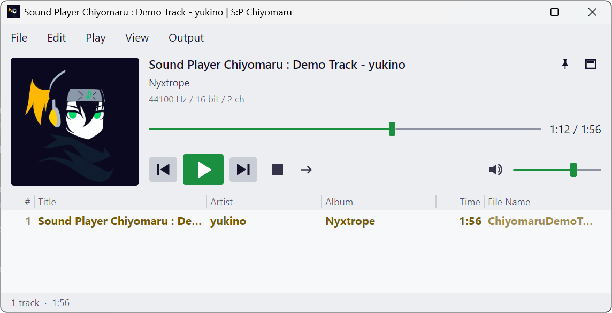
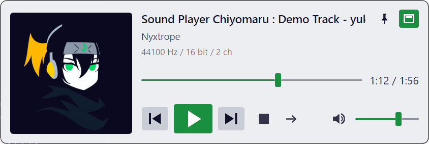
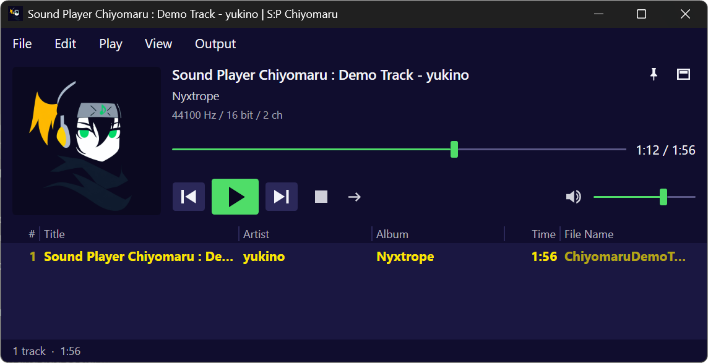

# SoundPlayerChiyomaru

English | [日本語](README.ja.md)

A lightweight, fast music player for Windows 11. Just drop in files or folders and play.

<p align="center">
  
</p>

## Features

- **Starts fast, stays light** — The window appears in about 0.1 seconds, and memory use stays under 100 MB while playing (measured on the author's machine). It is built with Native AOT, so no .NET runtime needs to be installed.
- **No library** — There is nothing to import or manage. Drag and drop the files or folders you want to hear onto the window. Your playlist is still there the next time you start the app.
- **Easy playlist editing** — Reorder by dragging, sort by clicking a column header, move the selected tracks, and undo or redo any edit.
- **No sound processing** — There is no equalizer or crossfade. WASAPI exclusive mode is supported.
- **Gapless playback**, ReplayGain, tags and album artwork, and media keys.
- **Portable** — Put the folder anywhere you like. Settings are saved in the same folder.
- **English and Japanese** — The app follows the Windows display language, and you can also choose one in the settings.

<p align="center">
  
  &nbsp;
  
</p>
<p align="center">Mini mode. Choose the app's own colors or the Windows colors, each in light, dark, or following the Windows setting.</p>

## Download

Download `SoundPlayerChiyomaru-<version>-win-x64.zip` from [Releases](../../releases) and extract it to a folder of your own (rather than straight into the Downloads folder, where other downloaded files sit next to it). The `-symbols.zip` file is only for investigating crashes; you do not need it to use the app.

The app is not signed, so Windows SmartScreen may show a warning the first time you start it. If it does, select "More info" and then "Run anyway".

## Requirements

- Windows 11 (64-bit)
- Nothing else to install.

## Supported formats

| Kind | Formats |
|---|---|
| Audio | MP3, FLAC, WAV, AAC (M4A), WMA |
| Playlists (open) | M3U8, M3U, PLS |
| Playlists (save) | M3U8 |

The app shows tags (title, artist, album, and so on) and album artwork. If a track has no embedded artwork, `folder.jpg` in the same folder is used.

## Usage

### Starting the app

Run `SoundPlayerChiyomaru.exe` in the extracted folder. Keep the other files in the folder (such as the `.dll` files) together with it.

Settings (`settings.json`) and the current playlist (`playlist.m3u8`) are saved in the same folder. To uninstall, delete the folder.

### Playing music

- Drag and drop audio files or folders onto the window.
  - Drop them on the playlist to insert them at that position.
  - Drop them anywhere else (around the title or the play button) to replace the playlist and start playing. In the settings, you can change this to "Add to the end" or "Add and play".
- Or use Open, Add Files, or Add Folder in the File menu.
- Double-click a track in the playlist to play from that track.

### Editing the playlist

- Drag tracks to reorder them. You can select several tracks and move them together.
- Right-click a track for commands such as Play from This Track, Play This Track Next, Sort, Shuffle Playlist, and Remove from Playlist.
- Move in the right-click menu moves the selected tracks up, down, after the current track, to the top, or to the bottom. Alt+↑ / Alt+↓ also move them up and down.
- Undo any edit with Ctrl+Z.
- Click a column header (Title, Artist, and so on) to sort by that column. Click it again to reverse the order. Sorting changes the order of the playlist itself, and you can undo it.
- Drag the border between headers to resize a column, or drag a header to move the column. Right-click a header to show or hide columns.
- The "#" column on the left is the original track order. The number stays with each track through shuffling and sorting, so Sort → Original Order (#) brings back the original order.

Removing a track from the playlist never deletes the file.

### Play modes

Switch modes with the button to the right of the stop button, or from Play Mode in the Play menu.

| Mode | Behavior |
|---|---|
| Normal | Plays in order and stops after the last track |
| Repeat One | Repeats the current track |
| Repeat All | Goes back to the first track after the last one |
| Random | Keeps picking tracks at random |
| One Shot | Stops when the current track ends |

To hear every track once in a random order, shuffle the playlist and play it in Normal mode.

### Exclusive mode

Choose a device in the Output menu and check Exclusive mode to let the app use that device on its own. With the volume at maximum and ReplayGain off, decoded audio reaches the device with its sample values unchanged, and a "BP" mark appears to the right of the title. If exclusive mode is selected but this is not possible, the mark changes to "× BP"; hover over it to see why.

While exclusive mode is on, other apps (including notification sounds) cannot play through that device.

### Mini mode

Press the button to the right of the title, or Ctrl+M, to hide the playlist and switch to a small window. Drag it by the title area. Press the same button or Ctrl+M again to switch back.

Right-click around the title or the playback buttons to open the same File, Play, View, and Output menus as the menu bar, plus Close. This lets you change the output or open the settings in mini mode too.

### Settings

Open them with Settings in the File menu, or Ctrl+,. Changes take effect immediately. You can change the output buffer length, the color theme (also in the View menu), which columns to show, what happens when another app opens a file, file associations, and more.

The display language is under Display → Language / 言語. Choose Follow Windows (the default), 日本語, or English. A new language takes effect after a restart; select Restart Now to restart right away. Your playlist and selected track are kept.

<p align="center">
  
</p>

### Keyboard shortcuts

| Action | Key |
|---|---|
| Play / pause | Space |
| Stop | Ctrl+Space |
| Next / previous track | Ctrl+→ / Ctrl+← |
| Forward / back 5 seconds | → / ← (or scroll the mouse wheel over the seek bar) |
| Volume up / down | Ctrl+↑ / Ctrl+↓ (or scroll the mouse wheel over the volume slider) |
| Mute | M |
| Mini mode | Ctrl+M |
| Always on top | Ctrl+T |
| Settings | Ctrl+, |
| Open | Ctrl+O |
| Save playlist / Save as | Ctrl+S / Ctrl+Shift+S |
| Undo / redo | Ctrl+Z / Ctrl+Y |
| Move selected tracks up / down | Alt+↑ / Alt+↓ |
| Remove from playlist | Delete |
| Select all | Ctrl+A |

Media keys on the keyboard (play, next track, and so on) also work.

## Building from source

You need:

- .NET 10 SDK
- The "Desktop development with C++" workload of Visual Studio 2022 or later (used to link Native AOT)

```
dotnet publish src/SoundPlayerChiyomaru -c Release -r win-x64 -o publish
```

The `publish` folder then contains everything needed to run the app. To build the release zips, run `tools/Publish-Release.ps1`.

To run the tests:

```
dotnet test
```

Built with .NET 10 (Native AOT), [Avalonia](https://avaloniaui.net/), and [NAudio](https://github.com/naudio/NAudio). The design, the reasons behind decisions, and measurements are in [docs/SPEC.md](docs/SPEC.md) (Japanese). The change history is in [docs/RELEASE_NOTES.md](docs/RELEASE_NOTES.md) (Japanese).

## License

[MIT License](LICENSE).

Licenses of the libraries used by this app are in [THIRD-PARTY-NOTICES.txt](THIRD-PARTY-NOTICES.txt). In the app, you can read them under About in the settings.
